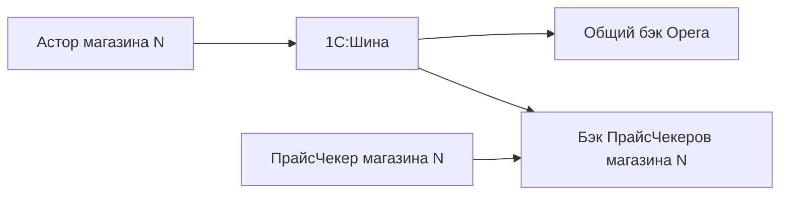

# Каталог для одной базы Opera и 500 баз ПрайсЧекеров

Уточнённая пользователем топология: 500 магазинных баз Астора; одна общая база бэка Opera; 500 баз бэков ПрайсЧекеров, по одной на магазин. Обе системы получают full/delta. Сканирование ПрайсЧекером обслуживает локальная база его бэка.

Данные собираются один раз. В одной транзакции создаются два пакета: Opera и PriceCheker, с разными batch_id, собственными каналами и независимыми ACK. У них общие источник, версия, полная сессия и набор карточек. Подтверждение одной системы не подтверждает вторую. Задержка отправки/ACK одного получателя не снимает пакет другого.

## Что подготовлено

Изменены два общих модуля: `КХ_ДанныеОпера` и `КХ_ОбменШиныОпера`. Исходные тексты до правки находятся в `ДоПравки`. Изменения отмечены semidockij, diff сохранён рядом. Модули `КХ_ДанныеПрайсЧекеры`, `КХ_ОбменШиныПрайсЧекеры` и штатный `Интеграция1СШина` менять не требуется: входящий обработчик ПрайсЧекеров уже принимает ACK своей внешней системы.

Состав — не группа, не помечен на удаление, не Закрытый и (Активный в назначенных магазину матрицах или ненулевой остаток). Диагностика 08 на базе пользователя дала 20 304 позиции: 18 123 активных и 2 181 дополнительно по остатку. Нет обязательного отбора по цене или штрихкоду; 1 429 без цены, 2 без штрихкода, 205 с отрицательным остатком сохраняются в рассчитанном составе. Отрицательный остаток не трактуется как положительный доступный запас. Иные статусы при появлении в ассортименте требуют отдельного бизнес-правила; сейчас они не приравниваются к Активный.

Для full и delta используется единый отбор. Исключённый товар возвращается в deleted_nomenclature_ids; это снятие из каталога магазина, а не физическое удаление объекта 1С. Бэк должен безопасно обрабатывать повторное снятие ещё неизвестного ID.

Список GUID full хранится отдельной технической записью `ВнешняяСистема=OperaState`, идентификатор session_id (UUID, 36 символов), узел `КХ_OperaFull`. Она не отправляется. Основная запись КХ_OperaState содержит только ссылку/прогресс, поэтому весь список не переписывается при каждой смене revision. После постановки последних двух пакетов список удаляется в той же транзакции; сами исходящие пакеты остаются до ACK. Поддержано чтение незавершённой старой сессии со списком внутри full. Узел КХ_OperaFull — технический ключ, его не регистрируют как участника Шины.

Незавершённая сессия старой редакции продолжается **только в Opera**: её первые порции не были отправлены PC. После окончания её подготовки для первичной загрузки PC нужно начать новую full-сессию; новая уйдёт обоим целиком. Уже подготовленные старые пакеты не изменяются и сохраняют свои batch_id.

Справочник СЕ из ЦО и full по входящему запросу бэка — следующий этап, описанный в Контракт_справочника_и_запросов.md. Установка этих двух модулей сама по себе таких обработчиков не добавляет.

## Адресация до запуска ПрайсЧекеров

Работающий сервис и каналы сохранены:

- сервис `ExchOperaPC`;
- Opera: `Основной_ExchangeOpera_FromOpera`;
- ПрайсЧекеры: `Основной_PriceChekerExc_FromShops`.

Для Opera оставлен существующий узел назначения и маршрут к общему бэку. Он должен быть единственным логическим получателем соответствующего потока.

Для ПрайсЧекеров задаётся конкретный код инфосистемы своего магазина. Принята **новая схема именования**, а не утверждение о существующих участниках: `pricechecker` + код СЕ. У магазина «Командор №50» код СЕ сейчас `123`, поэтому значение по умолчанию — **pricechecker123**, не pricechecker50.

Этот код должен совпасть с фактическим кодом информационной системы бэка в Шине и её членством в группе получателей PC. Если участник уже назван иначе, вписать его точный код в `КХ_ОбменШиныОпера.ПараметрыОбмена().КодПолучателяПрайсЧекеры` (в тексте функции — значение соответствующей строки Вставить). Пароли/секреты туда не помещать. Пустая настройка использует указанную схему имён; фактический исходящий код получателя пустым не остаётся, в том числе для старых PC-пакетов с пустым узлом.

Подготовка BSL не создаёт 500 участников и не меняет схему Шины. В тесте проверить, что пакет магазина №50 приходит именно его бэку, а второму магазинному бэку не приходит. Веб-интерфейс Шины из текущего окружения недоступен; маршрутизация, группы и аутентификация этим патчем не проверены.

## Порядок установки в тестовой базе

1. На время замены приостановить только наше задание `КХ_ОбменШиныОпера`. Существующие задания прежних интеграций сохранить со своими настройками.
2. Сохранить текущий текст двух модулей из базы. Заменить код из `ДляКопирования/КХ_ДанныеОпера.txt` и `ДляКопирования/КХ_ОбменШиныОпера.txt`. Если после присланной версии были другие правки, применить приложенный diff к текущей редакции.
3. Проверить синтаксис конфигуратором, обновить конфигурацию базы F7 и открыть новый сеанс.
4. Добавить источники событий матриц, как указано ниже. Сам модуль набора ПартииНоменклатуры с сетевым обменом не заменять.
5. Запустить `АвтоматическаяРегистрация/09_ПроверитьРабочийОтборБезОтправки.txt` через «На сервере». Ожидается около 20 304 позиций на неизменённых данных; сборка первой порции и снятие одной уже закрытой карточки проверяются без записи/отправки. В выводе сверить конкретный адресат PC.
6. Настроить/сверить адресата PC в Шине. Затем включить прежнее задание `КХ_ОбменШиныОпера` с прежним методом `КХ_ОбменШиныОпера.РегламентнаяОбработкаОчередиОпера`, каждые 10 секунд. Теперь оно отправляет обе очереди. Второе задание для сборки каталога ПрайсЧекеров не нужно. Старый метод PC остаётся совместимым отправителем/приёмником ACK, но отдельная копия регистратора full/delta не создаётся.

Эти действия не применены автоматически к серверной базе пользователя. До подключения бэков не считать ACK проверенным и не запускать массовую полную загрузку лишь ради проверки числа товаров.

## Две дополнительные подписки

1. В существующую общую подписку `КХ_ОпераСвойстваНоменклатурыПередЗаписью` добавить **РегистрСведенийНаборЗаписей.АссортиментныеМикроматрицы**. Событие ПередЗаписью, обработчик уже существующий `КХ_ОбменШиныОпера.НаборЗаписейПередЗаписью`. Он собирает старые и новые ссылки на номенклатуру. Отдельную дублирующую подписку на тот же источник/обработчик не создавать.
2. Создать подписку `КХ_НазначенияМатрицПередЗаписью`: источник **РегистрСведенийНаборЗаписей.НазначениеМикроматрицВСтруктурныхЕдиницах**, событие ПередЗаписью, обработчик **КХ_ОбменШиныОпера.НазначенияМатрицПередЗаписью**. Комментарий `semidockij - 23.10.2026 - Регистрация изменения ассортимента магазина`.

Существующие подписки номенклатуры, штрихкодов, цен, акций, свойств и партий остаются. Дублирование ПартииНоменклатуры в общей и отдельной подписках нужно убрать, как разобрано ранее. Новые обработчики используют поля подтверждённого запроса 07/08. Сами метаданные двух регистров пользователь ещё не прислал; компиляция, сигнатура события, периодичность и контроль замещения проверяются на платформе при установке. При ошибке обработчика не отключать контроль/не игнорировать исключение: это может потерять изменение.

## Проверка событий и доставки

На тестовом товаре последовательно проверить изменение цены; Активный → Закрытый; Пассивный с остатком; переход пассивного к нулю; назначение/снятие матрицы. При каждом изменении должны формироваться две записи одной версии — Opera и PriceCheker. Карточка либо ID снятия совпадают; batch_id разные. Для удаления последнего штрихкода и цены backend заменяет старое поле/массив, а не сохраняет прошлое значение.

Вернуть ACK только для Opera: подтверждённой становится только Opera, PC остаётся ожидающим. Затем ACK PC подтверждает его собственный batch_id. Повторы тела и ACK идемпотентны.

После подключения обоих бэков начать одну тестовую full-сессию. При 20 304 товарах и размере 200 получится 102 пакета на получателя, всего 204 записи. При перезапуске продолжается та же session_id; после постановки финальной пары технический список освобождается, исходящие записи остаются до ACK.

В общей базе Opera full одного магазина заменяет только данные этого store_id. Данные остальных 499 магазинов сохраняются. Каждый бэк PC принимает только свой store_id. Ни last-arrival, ни один nomenclature_id без store_id не подходят для обновления цены/остатка в общей базе Opera.

## Границы

Бэк ещё не готов. Новая поставка в PC, два независимых ACK, адресация по 500 бэкам, новые запросы/подписки и возобновление full пока не выполнены на платформе. Результат диагностики 08 подтверждает правило на данных, но не новую реализацию всех сценариев. Изменение справочников стран/единиц/групп, владельцев складов или категории цен СЕ по-прежнему требует массовой перерегистрации/новой полной загрузки либо отдельных подписок зависимостей. Физическое удаление без сохранённого внешнего ID не реализовано.
