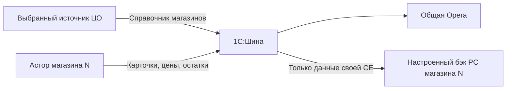

# Регистрация и публикация справочника магазинов

Редакция от 23.10.2026 установлена в тестовую базу по сообщению пользователя; модули заменены, подписки и задание созданы. Проверки 13/14 пройдены: выключатель, 3 full-порции Opera, всего 5 Opera/3 PC, прямые ACK и откат. Сеть и реальные подписки в этот сценарий не входят. 26.10.2026 пройден и сценарий 15: настоящие записи СЕ, пометка и снятие пометки сформировали 3 пары delta Opera/PC, откат восстановил исходное состояние. Реальные отправка и приём бэком ещё не проверены. Публикация по умолчанию **выключена** независимо от признака ЦО. Тестовый признак ЦО в базе магазина №50 не включает отправку. Новой константы/регистра не требуется: настройка, счётчик и маркеры хранятся в существующей ОчередьШины. Ниже сохранён порядок установки для новых баз.



## Состав правки

| Модуль | Действие |
| --- | --- |
| КХ_ОбменСтруктурныхЕдиниц | Новый: настройка, события, full/delta и отдельное фоновое задание |
| КХ_ОбменШиныОпера | Обновить: тип StructuralUnits в общей инфраструктуре отправки/повторов/ACK и фильтре собственных систем |
| КХ_ОбменШиныПрайсЧекеры | Обновить: диспетчер ACK справочника для своего PC |
| КХ_ДанныеСтруктурныхЕдиниц | Сохранить последнюю редакцию с closing_date=null у работающего магазина |

**Зависимость от предыдущей поставки:** полный КХ_ОбменШиныОпера.txt включает также ранее подготовленный каталог двух проектов от 23.10.2026. Если правка КаталогДляДвухПроектов ещё не установлена, вместе с ним нужен соответствующий **КХ_ДанныеОпера.txt** и его подписки матриц, согласно отдельной инструкции. Иначе товарное задание будет вызывать отсутствующий метод СформироватьСостояниеКаталога. ДанныеПрайсЧекеры не изменяется. Текущая папка ДоПравки содержит исходники непосредственно перед публикацией СЕ; более ранняя рабочая редакция сохранена в КаталогДляДвухПроектов/ДоПравки. Если после присланных текстов в базе были дополнительные изменения, сверить diff с текущим исходником перед заменой.

Низкоуровневые захват/попытка отправки/фиксация результата не переписывались. Товарные заголовки, source_revision и набор карточек этой правкой не меняются. Новая система **StructuralUnits** изолирована от Opera/PriceCheker. Штатный Интеграция1СШина и модули объекта СЕ/набора партий не заменяются.

## Сейчас: установка и проверка без отправки

Готовые тексты: [новый регистратор](/workspace/1c_shop50/ДляКопирования/КХ_ОбменСтруктурныхЕдиниц.txt), [обмен Opera](/workspace/1c_shop50/ДляКопирования/КХ_ОбменШиныОпера.txt), [обмен PC](/workspace/1c_shop50/ДляКопирования/КХ_ОбменШиныПрайсЧекеры.txt), [данные СЕ](/workspace/1c_shop50/ДляКопирования/КХ_ДанныеСтруктурныхЕдиниц.txt), [данные каталога Opera при отсутствии предыдущей правки](/workspace/1c_shop50/ДляКопирования/КХ_ДанныеОпера.txt).

1. В тестовой базе сохранить текущие тексты изменяемых модулей; приостановить собственные задания на время замены. Настройки прежних интеграций не менять.
2. Добавить серверный неглобальный общий модуль **КХ_ОбменСтруктурныхЕдиниц**; повторное использование возвращаемых значений — Не использовать. Текст в ДляКопирования/КХ_ОбменСтруктурныхЕдиниц.txt.
3. Обновить два модуля обмена из актуальных TXT, проверить зависимость КХ_ДанныеОпера выше. Обновить читающий модуль СЕ до последней редакции, если поправка даты ещё не установлена. Все модули должны присутствовать до проверки конфигурации: между ними есть новые экспортные вызовы.
4. Проверить синтаксис, F7, новый сеанс. Выполнить [13_СтатусПубликацииСЕБезОтправки.txt](/workspace/1c_shop50/АвтоматическаяРегистрация/13_СтатусПубликацииСЕБезОтправки.txt) через «На сервере». Ожидается публикация Нет, даже при «База ЦО: Да». Чтение статуса само не создаёт техническую запись.
5. В этой же тестовой базе выполнить [14_ПроверитьРегистраторСЕСПОткатом.txt](/workspace/1c_shop50/АвтоматическаяРегистрация/14_ПроверитьРегистраторСЕСПОткатом.txt) через «На сервере». Он временно задаёт тестовые адресаты, готовит full, событие записи и удаления и имитирует ACK. Затем **отменяет всю транзакцию** и сверяет исходное состояние. В нём нет отправителя, сервисов интеграции, Записать/Удалить СЕ или вызова регламентного задания. Никакой объект СЕ не удаляется. Имена TEST_OPERA_NO_SEND/TEST_PC_NO_SEND — заглушки только внутри откатываемой транзакции, участников Шины с такими именами создавать не надо.

При неизменном справочнике 567+16=583 записи: 3 full-порции Opera по 200 и 1 полный пакет только PC текущего магазина. Две тестовые delta дают ещё 2 Opera и 2 PC, итого в транзакции 5 Opera и 3 PC. Окончательный вывод: «ОТКАТ выполнен…». При другом числе СЕ количество full-порций может отличаться; сценарий считает его автоматически. Если сценарий завершился ошибкой, его обработчик отменяет транзакцию и выдаёт исходную ошибку.

Эта проверка исполняет регистратор и диспетчер ACK внутри платформы, но не проверяет реальные события подписок, конкурентную запись, сетевую отправку, маршрутизацию, повтор после перезапуска и обработку бэком.

## Подписки для авторитетного источника

Создать после успешной проверки, не заменяя штатные обработчики объекта:

| Имя подписки | Источник | Событие | Обработчик |
| --- | --- | --- | --- |
| КХ_СЕПередЗаписью | СправочникОбъект.СтруктурныеЕдиницы | ПередЗаписью | КХ_ОбменСтруктурныхЕдиниц.ПередЗаписьюСЕ |
| КХ_СЕПриЗаписи | СправочникОбъект.СтруктурныеЕдиницы | ПриЗаписи | КХ_ОбменСтруктурныхЕдиниц.ПриЗаписиСЕ |
| КХ_СЕПередУдалением | СправочникОбъект.СтруктурныеЕдиницы | ПередУдалением | КХ_ОбменСтруктурныхЕдиниц.ПередУдалениемСЕ |
| КХ_СЕСвязанныйСправочникПриЗаписи | СправочникОбъект.ФорматыМагазинов; СправочникОбъект.ТерриториальныеОбразования; СправочникОбъект.СубъектыРФ | ПриЗаписи | КХ_ОбменСтруктурныхЕдиниц.СвязанныйСправочникПриЗаписи |

Комментарий новых подписок: semidockij - 23.10.2026 - Регистрация справочника магазинов для шины. В магазинных базах обработчики возвращают управление при выключенной публикации, в том числе при загрузке из обменов. На выбранном источнике ЦО загрузка не пропускается автоматически: значение могло измениться и через обмен. Все записи маркеров выполняются в транзакции исходной операции; ошибка/Отказ/откат не должны оставлять внешнее событие.

Запись фиксирует прежний вид СЕ перед изменением и регистрирует текущую ссылку после записи. Смена вида Магазин на другой вид становится снятием карточки. Физическое удаление сохраняет внешний ID до исчезновения объекта. Смена постоянного внешнего ID для магазина отклоняется: это отдельная миграция ключа. Имена формата, территории и региона регистрируются отдельной общей подпиской, потому что сами СЕ при переименовании этих справочников не записываются.

## Подключение отправки после готовности маршрутов и бэков

Это следующий этап проверки; во время теста 14 он не выполняется. На выбранной фактической базе ЦО в стабильном контексте фонового пользователя настроить явные адресаты:

```bsl
МаршрутыPC = Новый Массив;
// Пример схемы настройки. Код участника должен быть реальным кодом бэка в Шине.
МаршрутыPC.Добавить(Новый Структура("store_id,node",
    "3370588b-0742-11e0-b9c1-001a64c3f566", "pricechecker123"));
КХ_ОбменСтруктурныхЕдиниц.НастроитьПубликацию(Истина, "BackendOpera", МаршрутыPC);
```

BackendOpera ранее наблюдался в Шине, но фактический код адресата ЦО надо сверить; pricechecker123 пока только предложенная схема имени. Команда сохраняет настройку и запрашивает full, сама не вызывает сеть. Пустой массив PC означает публикацию только в Opera. Для 500 PC заполняется соответствие постоянного store_id и фактического участника; не используется номер магазина или широковещательная группа. Настройка привязывает source_id и source_node к выбранному контексту источника; он должен совпасть с контекстом фонового задания. Тестовую базу нельзя включать на боевые адресаты. Копия ЦО может унаследовать включённое состояние: после восстановления копии его нужно отключить и использовать тестовых участников.

Создать **отдельное** регламентное задание КХ_ПубликацияСправочникаСЕ, метод **КХ_ОбменСтруктурныхЕдиниц.РегламентнаяОбработкаСправочника**, каждые 10 секунд, только на выбранном источнике. Оно готовит до 100 dirty-СЕ и одну порцию full, затем отправляет до 20 своих пакетов и обрабатывает сервис. Существующее товарное задание не начинает отправлять StructuralUnits. Задание должно иметь права чтения справочников и записи ОчередьШины; настройку и запуск сверять с его фактическим пользователем/СЕ.

Сохраняются ExchOperaPC и два действующих исходящих канала. Новый заголовок **ТипСообщения=StructuralUnits**, тело message_type=structural_units. В схеме Шины/бэках нужна соответствующая обработка нового типа с сохранением прежней обработки products; существование каналов само по себе её не доказывает. Opera получает общий справочник, PC только свою СЕ. ACK справочника должен вернуться **в базу-источник ЦО**, адрес которой source_node, а не в соответствующий магазинный Астор. В обратных каналах диспетчеры отличают его по dataset.

## Пауза и продолжение

```bsl
КХ_ОбменСтруктурныхЕдиниц.НастроитьПубликацию(Ложь);
```

Пауза сохраняет счётчик, эпоху, снимок и подготовленные пакеты; новые попытки отправки останавливаются, уже начавшаяся попытка может завершиться. ACK ранее отправленного пакета остаётся допустимым. Повторное включение без новых адресатов сохраняет маршруты и запрашивает новый full, чтобы восполнить изменения, произошедшие во время паузы. Если до паузы готовилась другая full-сессия, она завершается, затем начинается новая. Во время активной сессии маршруты менять нельзя.

full_active означает подготовку, не доставку. Не удалять КХ_СЕState/счётчик/эпоху вручную. Старые неподтверждённые пакеты сохраняются, подтверждённые удаляет общий собственный очиститель по сроку. Переезд источника, изменение кода участника/маршрута и восстановление из старой резервной копии требуют согласованного полного восстановления; автоматический перенос старого ожидающего пакета другому участнику не выполняется.

## Границы этой поставки

Реализованы исходящий справочник, события, выключатель и ACK. Входящие **catalog_full_request** и **structural_units_request** ещё не реализованы; текущие входящие обработчики новых запросов не принимают. Это следующий отдельный этап. Полную выгрузку справочника сейчас можно запросить из 1С методом НачатьПолнуюВыгрузку, с сохранением одной активной сессии. На платформе и реальном бэке новая поставка ещё не проверена; сборщик сценария 11 ранее подтверждён пользователем.
