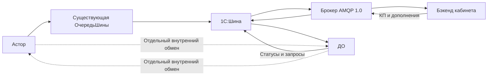

# Потоки обмена

ДО не является транзитом справочников Астора в кабинет. Конкретные адреса AMQP `source/target` и физические имена каналов задаются по стенду.

Пакет Астора содержит:

- `categories` — категории;
- `formats` — форматы;
- `territories` — территории с регионами;
- `structural_units` — СЕ;
- `responsible_users` — сотрудники с GUID, ФИО, табельным номером и ролями;
- `category_format_assignments` — привязки категория/формат → КМ/байер.

Источником ответственных и назначений служит `РаспределениеКМПоКатегориям`. В новых пакетах используется версия схемы 2; старая схема 1 принимается утилитой для завершения ранее созданных сообщений.

Общее исключение штатной обработки по-прежнему проходит через `КХ_ОбменШиныОпера.СистемыСобственнойОчереди()`. Она делегирует нейтральному реестру. Сам `Интеграция1СШина` остаётся неизменным.

У собственной очереди кабинета отдельные отправка, статусы, квитанции и очистка. Обработчики Opera/ПК не должны выбирать сообщения кабинета из-за расширения общего перечня. Проверка изоляции контролирует и новый реестр, и фактическую старую точку входа.

Хеш и ревизия находятся в служебном значении существующего поля `Объект`; точный JSON — в `СтроковыйОбъект`. Самый новый обычный снимок сохраняется собственной очисткой для сравнения изменений. Удаление всей истории очереди требует согласованной начальной синхронизации — прежнюю ревизию из пустого регистра восстановить нельзя.

Транспортный ID и `message_id` пакета различаются. Подтверждение передачи транспорту не доказывает применения данных бэкендом. Текст обработчика результата готовится под явный прикладной контракт и ещё требует привязки к фактическому входящему каналу.
