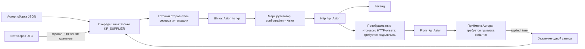

# Текущий вариант: HTTP и буфер на 72 часа

Последнее решение 05.11.2026: использовать существующую ОчередьШины; удалять пакет после подтверждённого успеха бэка; недоставленные удалять по истечении 3 суток с записью в журнал. Новых регистров/констант нет, защищённые модули не редактируются.

Рабочие имена узлов и Authorization сохраняются по присланному проекту. Дополнительная оболочка исходящего тела для бэка не создаётся. Новый JSON supplier.http.result относится только к внутреннему результату Шина → Астор; рабочий проект пока сам этот отчёт не формирует.

Из готового кода используются сборщик справочников/ответственных, JSON-утилиты, публичная регистрация очереди и UTF-8 транспорт. Новый адаптер отвечает только за собственную область регистра, дедлайн, повтор, проверку корреляции и удаление. Подробно: reuse-and-queue-72h.md.

Входящий поток КП Бэк → KP.GET → message_kp → kp_to_DO → DocumentManager сохраняется. Он не заменяется GET-опросом. Внутренний обмен Астор ↔ ДО остаётся самостоятельным. Из модулей ShelfSpace найдены только прямые HTTP-клиенты: их очередь и авторизация не подключаются к кабинету.

Пакеты собственного формата KP_HTTP_BUFFER_V1 имеют неизменный ID и тело. Срок UTC задаётся один раз. Транспортный ID лежит в служебном Объект; ключи записи не меняются. Удаление выполняется менеджером записи по всем пяти измерениям. Возврат отправки в Шину не равен успеху бэка.

Истечение срока удаляет и ошибочные/остановленные пакеты; архив тела после этого отсутствует. Уже запущенный запрос может завершиться после удаления локальной записи. Поздние/повторные результаты не регистрируют её повторно. У старых форматов требуется отдельный разбор, новый код их автоматически не удаляет.

Автоматические повторы и порядок применения полных снимков требуют проверки контракта бэка. Текущий код не вводит устойчивые ревизии и не реализует «только изменения». Из-за удаления успешных пакетов очередь не может служить вечным хранилищем последнего хеша. События изменения источников подключаются отдельно.

Не выполнены компиляция 1С/Шины, проверка запросов/прав/гонок на базе, привязка приёмного события и преобразования HTTP-ответа. Подготовленный комплект по умолчанию выключен; наличие функций адаптера не означает восстановленный сквозной обмен.
