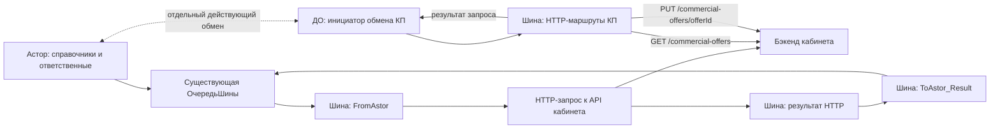

# HTTP-обмен кабинета поставщика

Решение пользователя от 04.11.2026 заменяет прежний вариант AMQP. Шина остаётся. Под HTTP здесь понимается HTTPS для внешнего API; существующий сервис интеграции Астора сохраняется.

ДО не является транзитом справочников. Стрелка к бэкенду обозначает HTTP-запрос; его ответ возвращается в Шину. Бэкенд не вызывает входящий HTTP-сервис Астора. Браузер поставщика не участвует в техническом обмене.

## Подтверждено исходниками

ТЗ описывает синхронные PUT /categories, GET /commercial-offers?startDate=... и PUT /commercial-offers/{offerId}; внешний доступ по HTTPS и X-API-Key. Примеры company.com не являются адресами стенда. В OpenAPI description есть противоречащее основному тексту упоминание асинхронных событий; оно не используется как требование к новой реализации. Две записи security в OpenAPI означают альтернативные способы аутентификации, а не обязательное сочетание API Key и OAuth.

У PUT /categories отсутствует определённый requestBody. Фраза nested JSON не задаёт контракт для всего снимка. Не подтверждены приём ответственных, атомарность, идемпотентность, защита от устаревшей ревизии и прикладной смысл HTTP 200. Новый код нельзя считать совместимым с этим методом только по совпадению названия.

## Снимок Астора

Сборка сохраняется: categories, formats, territories, structural_units, responsible_users, category_format_assignments. Источник ответственных — РаспределениеКМПоКатегориям. В пакете сотрудники и роли; пароли и учётные записи входа в портал здесь не создаются.

Полный JSON версии 2 сохраняется неизменным в СтроковыйОбъект. Служебный маркер, ревизия, хеш, текущая попытка HTTP и срок повтора — в существующем Объект. Новых регистров и констант нет. Интеграция1СШина и Интеграция1СШинаПереопределяемый не меняются.

Базовый вариант контракта: один PUT атомарно применяет все шесть наборов. Требуется согласованное расширение /categories либо отдельный ресурс полного снимка, например /supplier-reference. Последний адрес — предложение, не существующий API. Делить пакет на независимые успешные PUT без версии снимка и завершающей операции нельзя: можно получить категории от одной ревизии и назначения от другой.

Получатель должен распознавать повторы по source_system + dataset + scope + message_id, не применять старую revision поверх новой, отклонять повторный ID с другим содержимым. Один Idempotency-Key не обеспечивает этого без реализации на бэке. В выбранной модели 200 означает сохранение полного снимка; пустое тело допустимо. Если бэк отвечает 200 до сохранения либо возвращает ошибку в теле с кодом 200, этот контракт не подходит: обработчик требуется адаптировать.

## Изменения в Асторе

- HTTPКонтрактПодтвержден = Ложь до сверки API. Флаг не заменяет проверку.
- ВерсияHTTPМаршрута входит в route_hash. При смене ресурса/контракта изменить её. Старые сообщения не переносятся на новый маршрут автоматически.
- ИдентификаторПопыткиHTTP меняется при новой отправке в Шину; application message_id и JSON при повторе сохраняются.
- Резервирование попытки фиксируется локально до сети. Сетевой вызов не находится в транзакции. Отправлено означает отправку/ожидание результата, а не применение на бэке.
- supplier.reference.http-result формируется Шиной из контекста исходного HTTP-запроса и поступает по выделенному каналу. Это не публичная квитанция бэка.
- Проверяются correlation_id, revision, content_hash, attempt_id. Поздняя ошибка старой попытки игнорируется; поздний 200 для того же неизменного пакета подтверждает применение. Ранний результат не затирается возвратом отправки.
- Повторный результат одной попытки не продлевает Retry-After. Срок повтора отсчитывается по часам Астора.
- По умолчанию повтор >=60 с, ожидание отсутствующей квитанции >=900 с; фактическая задержка зависит от расписания. Нужен один активный отправитель.
- Лимит Астора 5 МиБ намеренно ниже верхнего ограничения 100 МБ из ТЗ. При превышении нужна согласованная пакетная передача.

## Результаты HTTP

| Код | Результат | Очередь |
|---|---|---|
| 200 | applied, только при подтверждённом синхронном контракте | ДоставкаПодтверждена, ДатаЗагрузки |
| 0 (нет ответа), 408, 425, 429, 5xx | retry | Ошибка, отложенный повтор с учётом Retry-After |
| 400, 413, 415, 422 | rejected | Отменено, без автоматического повтора |
| 202, 204, 3xx, 401, 403, 404, 405, 409 и прочие | blocked | Отменено, ручной разбор |

409 не доказывает успешный дубликат: возможен конфликт содержимого/ревизии. 202 требует отдельного API проверки операции и пока не поддерживается. Другие коды синхронного успеха можно добавить только по реальному контракту. HTTP 0 используется только когда ответ действительно не получен; при неизвестном исходе повторяется тот же message_id.

ТекстОшибки содержит код и классификацию. Тела HTTP-ответов и секреты туда не копируются. После исправления ключа без смены логического ресурса тот же пакет возобновляется ПовторитьHTTPПакет. После исправления данных создаётся новый снимок. При смене назначения требуется новая версия маршрута и явное решение о старой очереди.

## Коммерческие предложения и ДО

Инициатор GET — ДО через Шину. Ответ GET нужно сохранить в ДО, затем продвинуть курсор; HTTP 200 не доказывает локальную запись КП. Для повторной загрузки нужны устойчивый ID КП и версия/время изменения. Перед PUT изменений исходящие данные устойчиво регистрируются действующим механизмом ДО.

ТЗ задаёт только startDate, но не пагинацию, верхнюю границу выборки, включительность границы, стабильную сортировку и обработку одинаковых времён изменения. Нельзя сохранять текущее время опроса как курсор после одной страницы. Нужен курсор API либо стабильная пара modified_at + id с перекрывающимся окном и дедупликацией. Хранилище курсора выбирается из реально существующих механизмов ДО; новые регистры не проектируются.

Исходные модули и метаданные ДО не предоставлены: готовый компилируемый загрузчик КП здесь не заявляется. Нет экспорта/исходника HTTP-компонента проекта Шины: инструкция настройки является заданием на реализацию, не проверенным импортом.

## Пределы проверки

Сборка не даёт согласованного снимка всей базы одной транзакцией: запросы могут видеть изменения между чтениями. Сохранены исходные GUID и бизнес-правила отбора; их и глубину категорий проверить на стенде. BSL ещё не выполнялся в 1С. Реальных URL, ключей и доступа к базам нет; сетевой обмен не проверен.
