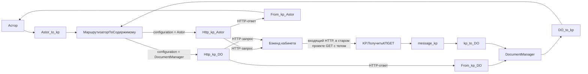

# Рабочая схема пользователя, HTTP без прикладной очереди

Актуально с 05.11.2026. Приоритет: запрет записи в ОчередьШины и присланный код Integration/KP. Прежний вариант от 04.11 с собственным обработчиком регистра отозван и сохранён в истории.



HTTP-узлы выполняют запрос и получают ответ той же операции. Программный источник message_kp — отдельный входящий маршрут. Существующий внутренний обмен FromDO → ToAstor / FromAstor → ToDO остаётся отдельно.

## Связка Астора и маршрутизатора

Параметр configuration находится в Сообщение.Параметры. В Асторе заполняется:

```bsl
Сообщение.Параметры.Вставить("configuration", "Astor");
```

Точные значения маршрутов — Astor и DocumentManager. Неизвестное или отсутствующее значение в присланном маршрутизаторе даёт пустой список получателей, а не резервный маршрут. При тестировании такой случай должен фиксироваться как ошибка маршрутизации; пустой список нельзя трактовать как успешную отправку на бэк. Наш отправитель всегда задаёт Astor. Политика Шины для пустого результата требует проверки в проекте.

## Авторизация и тело

Рабочий код использует Authorization = Integration.Параметры.API_key. Сохраняется полное значение, включая префикс, только если он нужен фактическому API. Нельзя самовольно добавлять Bearer/Basic или менять заголовок на X-API-Key из ТЗ.

HTTP-подготовка получает поток тела сообщения и устанавливает его в тело запроса. Это позволяет сохранить готовый JSON без вложенной JSON-строки. Новый отправитель Астора пишет UTF-8 без BOM/перевода строки, а код Шины задаёт Content-Type application/json; charset=utf-8.

Адаптация сборщика выдаёт шесть массивов верхнего уровня: categories, formats, territories, structural_units, responsible_users, category_format_assignments. Упаковка schema_version/revision/payload отозвана: присланная Шина её не распаковывает. Но точный контракт бэка не предоставлен, поэтому совместимость расширенного набора с рабочим /categories всё ещё требует проверки. Для проверки транспорта можно передать в ОтправитьJSON ровно тот JSON, который уже принимался бэком.

## Что делает и чего не делает рабочий код

Методы ПодготовкаЗапроса задают заголовки и тело. Они не показывают реальный метод HTTP, URL, endpoint и политику повторов: эти свойства проверяются на узле. Нельзя заключить по имени Http_kp_Astor, что настроен именно PUT.

В From_kp_AstorОбновлениеМетрик и From_kp_DOОбновлениеМетрик код ответа лишь присваивается локальной переменной. В показанном коде нет обновления состояния, разбора тела, обработки ошибок или подтверждения применения. Каналы ответа на схеме есть; содержимое и параметры сообщения в Асторе нужно проверить по реальному входящему обработчику. Не вводится выдуманная оболочка supplier.reference.http-result, которую проект сейчас не создаёт.

Вызов СервисыИнтеграции.ОтправитьСообщение не равен HTTP 200 и не означает запись на сайте. Платформа и Шина могут иметь собственное служебное хранение; запрет пользователя относится к обращению нашего кода к прикладному регистру. Никакое хранение статусов в этом регистре не выполняется.

## Приём КП через KP

ПолучитьКПGETОбработкаЗапроса — обработчик ВХОДЯЩЕГО сервиса Шины. Он читает тело, создаёт СообщениеИнтеграции, отправляет его в message_kp и отвечает вызывающему. Это push со стороны вызывающей системы. Http_GMCSПодготовкаЗапроса и Survey_kpПодготовкаЗапроса в присланном фрагменте только возвращают Запрос; этого недостаточно, чтобы установить наличие и настройки отдельного polling-процесса.

GET с телом имеет ненадёжную совместимость с прокси/клиентами. Для доставки КП разумен POST, но рабочий GET не переименовывается автоматически: это требует согласованного изменения шаблона Шины и клиента бэка. Если GET действительно используется, старый маршрут можно сохранить на время перехода. Независимые push/polling одного набора нельзя включать без дедупликации.

IsJSON сейчас содержит строку Content-Type, а не логическое значение. Проверка Содержит(application/json) не разбирает JSON и может принять неверный media type. Пустое/повреждённое тело также не проверяется. ПрочитатьКакСтроку(...).ВБайты() повторно преобразует тело; исходная байтовая неизменность этим кодом не доказана. API безопасного переноса/проверки тела нужно сверять в установленной Шине, не заменять на выдуманные методы.

Ответ «Проверка в ДО!» означает завершение вызова постановки в программный источник. Сохранение КП в ДО к этому моменту кодом не подтверждено. Корректнее текст «Передано в Шину для доставки в ДО». Result=false в JSON не меняет HTTP-статус: в ОтправитьОтвет показанный код его явно не задаёт. Нужны корректные 400/415 для ошибок и согласованный код приёма; свойство установки статуса требуется подтвердить по API вашего HttpСервисОтвет. Настройки аутентификации публикации в фрагменте также не показаны; существование или отсутствие защиты по этому фрагменту не устанавливается.

## Нет скрытого сохранения состояния

Новые модули не обращаются к ОчередьШины и не вызывают Интеграция1СШина/переопределяемый модуль. Не требуется расширять метки исключений Opera/ПК. Никаких очисток, блокировок и заданий обработки регистра не создаётся. Не создаются заменяющие регистры/константы.

Каждый явный вызов полной сборки даёт полный снимок. Отправка только изменений, устойчивый порядок ревизий и дедупликация не заявляются без реальной схемы регистрации и контракта бэка. Для повторов HTTP используются возможности Шины, но их поведение при 4xx/5xx, таймауте и перезапуске ещё нужно проверить. Повтор PUT безопасен только при соответствующей семантике API.
