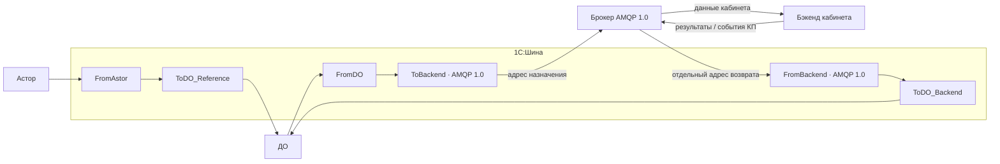

# Схема кабинета поставщика в 1С:Шине

Статус: проект изменения схемы по примеру Opera на скриншоте. Утверждённые пользователем условия: Астор → ДО → бэкенд; Шина остаётся; внешний обмен — AMQP 1.0; разработка бэкенда выполняется другой стороной. Реальный проект Шины не изменён: его экспорт и подключение к среде разработки не представлены.

## Компоновка

Информационные системы в проекте: Astor, DocumentManager, BackendKP. Названия предлагаемые. Астор — «Торговый дом 7 SE» 7.0.33.7 на платформе 8.3.27; ДО — 3.0; указанная версия Шины — 8.1.3.

Имена каналов читаются относительно Шины: From — вход в Шину из названной системы, To — выход из Шины в названную систему. Протокол подключения баз Астора и ДО остаётся отдельным от внешнего AMQP 1.0.

Брокер изображён отдельно для ясности транспорта. В редакторе проекта его представление отдельным узлом зависит от поддерживаемых компонентов: объект BackendKP может обозначать логического участника, а брокер задаваться в подключении AMQP. Зелёная/синяя полоска и иконка старого канала на скриншоте не подтверждают тип нового AMQP-компонента.

## Шесть основных каналов

| Пара каналов | Поток | Обработчик на стороне базы |
|---|---|---|
| FromAstor → ToDO_Reference | Снимок категорий, форматов, территорий, СЕ и распределения из Астора в ДО | ДО проверяет, сохраняет и применяет ревизию, фиксирует готовность публикации |
| FromDO → ToBackend | Подготовленные данные кабинета; в дальнейшем статусы и запросы по КП | ДО выдаёт уже подготовленное исходящее сообщение; Шина публикует его по AMQP 1.0 |
| FromBackend → ToDO_Backend | Результат импорта справочников; в дальнейшем КП, дополнения и отзыв | ДО различает типы сообщений, обновляет состояние доставки либо запускает обработку КП |

Первая реализация охватывает справочники и результат их применения. Бизнес-события КП подключаются следующим этапом. Если backend сообщает разные типы на разных AMQP-адресах, входящие каналы и подписки разделяются соответственно. Это уточняется по контракту; одна общая очередь для любых сообщений не предполагается.

Главное условие: ToDO_Reference доставляет пакет в ДО; дальнейшую публикацию инициирует ДО только после успешной обработки. Соединять FromAstor напрямую с ToBackend нельзя — это обойдёт требуемую последовательность.

## Контракт и настройки

Названия прикладных сообщений предлагаемые:

- astor.reference.snapshot — внутренний пакет Астор → ДО;
- supplier.reference.snapshot — исходящий пакет ДО → бэкенд;
- supplier.reference.result — результат бэкенд → ДО;
- supplier.offer.submitted, supplier.offer.updated, supplier.offer.withdrawn — последующие потоки КП.

Тип сообщения и адрес AMQP — разные сущности. Точный адрес, привязки, имена очередей и правила создания определяет согласованная конфигурация брокера. В AMQP 1.0 нужно описать source/target и поведение delivery outcome/settlement; настройки AMQP 0-9-1 нельзя переносить автоматически.

В теле JSON UTF-8: schema_version, message_id, message_type, source_system, dataset, scope, revision, mode, generated_at, content_hash, payload. Результат содержит correlation_id исходного сообщения, ревизию, status и сведения об ошибке. Корреляция и идентификаторы должны согласованно отображаться на свойства AMQP 1.0, если адаптер предоставляет такую возможность.

Параметры подключения по смыслу: узел и порт брокера, TLS, способ аутентификации, исходящий target, входящий source, лимит размера сообщения, интервалы повторов и ограничения потребления. Конкретные имена свойств берутся из поддерживаемого AMQP 1.0-коннектора Шины. Старые HTTP-параметры URL, Endpoint и API_key не считаются готовыми AMQP-настройками. Секреты не встраиваются в схему и BSL.

## Надёжность

1. Астор устойчиво фиксирует исходящий снимок; потеря соединения не теряет сообщение.
2. ДО применяет входящую ревизию и фиксирует своё исходящее сообщение в одной локальной транзакции. Передача брокеру выполняется после неё.
3. Шина/адаптер обрабатывает результат публикации; неопределённый исход после обрыва допускает повтор с прежними message_id и телом.
4. Потребитель подтверждает доставку после надёжного сохранения входящего сообщения либо после полной обработки. Входящий журнал принимает на себя повторы и восстановление, если подтверждение выполнено до применения.
5. Отдельное supplier.reference.result подтверждает прикладное применение бэкендом. Принятие брокером или settlement доставки не заменяет этот результат.
6. Повторы распознаются по идентификатору, старые данные — по ревизии. Временные сбои получают отложенную повторную попытку; невалидные сообщения сохраняются для разбора.

Если Астору нужно видеть не только принятие каналом, но и применение в ДО, добавляется служебный маршрут FromDO_Result → ToAstor. Это отдельный результат обработки, не возврат КП или справочников из сайта в Астор.

## Перенос из старой схемы

1. Сохранить экспорт действующего проекта, обработчики каналов и настройки без секретных значений.
2. Проверить поддержку AMQP 1.0 установленной Шиной и параметры брокера. По изображениям совместимость не установлена.
3. Создать/переиспользовать системы Astor, DocumentManager, BackendKP и каналы указанных направлений. Проверить обработчики существующих FromAstor, ToDO и DO_to_kp перед переименованием.
4. Реализовать применение снимка в ДО и отдельную выдачу его подготовленного пакета в FromDO.
5. Настроить исходящую публикацию ToBackend и входящий FromBackend на тестовых AMQP-адресах.
6. Проверить полный проход, повтор после обрыва, недоступность брокера, ошибочное сообщение и прикладной результат. Сквозное применение на бэкенде проверяет совместное испытание с его разработчиком.
7. После сверки переключить действующий поток. Отключить старые HTTP-отправители этого потока, проверить отсутствие двойной доставки.

Это проект схемы для реализации в конфигураторе/редакторе Шины, не импортируемый экспорт и не утверждение о готовом соединении с брокером.
